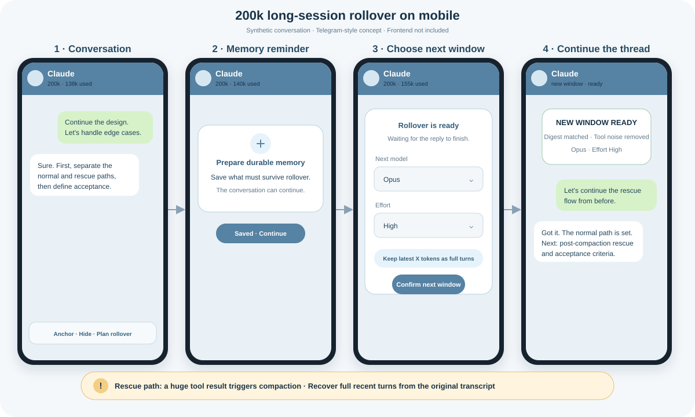

# claude-precompact-rollover

Build the next Claude Code window from **recent verbatim turns + pinned context − hidden noise**, then verify the handoff before switching.

The project is aimed first at ordinary 200k-context users. Its primary goal is to avoid spending time and quota on repeated automatic compaction; its second goal is to carry forward the exact wording that holds tone, names, promises, preferences, and other continuity cues instead of trusting one generated summary to choose them.

## 产品视角

针对 Claude Code 200k 长会话反复自动压缩、等待时间长且可能丢失原话的问题，我提出并定义了分阶段提醒、最近 X Token、Pin、Hide、压缩后救援和 SHA-256 内容校验流程。它不是替模型写另一份摘要，而是让用户自己决定下一窗口真正继承什么。

我负责提出需求、确定产品方案与验收标准；代码实现和自动化测试由 AI 完成。完整过程见 **[中文产品案例：如何在自动压缩前安全接续长会话](docs/PRODUCT_CASE_ZH.md)**。



*合成体验示意图，不包含真实聊天内容；移动端界面属于集成层，本仓库提供可供界面接入的计划接口与换窗核心。*

## What it does

- At 140k prompt tokens, emits a preparation reminder so the current model can save durable memories.
- At 155k, emits an urgent reminder.
- At 160k, waits for a complete assistant reply and prepares a rebuilt session.
- If a tool call jumps past the safe range and compaction happens first, enters rescue mode and reads the original pre-compaction turns from the append-only transcript.
- Keeps the latest configurable X tokens as complete user/assistant turns.
- Accepts a versioned `context-plan.json`: pin older messages, hide selected noise, and choose the next model/effort from any local frontend or app.
- Offers a metadata-only preview before rebuilding and returns source-to-target mappings for pinned messages afterward.
- Excludes tool output floods, thinking blocks, compact summaries, and inherited usage counters.
- Verifies a SHA-256 digest of source and rebuilt visible content before marking the target ready.
- Lets the user choose the next model and effort independently of the source window.
- Disables automatic rollover for configured 1M-context models by default. Manual rebuild and post-compaction rescue remain available.

It does **not** call another model to summarize history. Pin and Hide are both message-level: Pin guarantees only the selected original message, while an unselected partner becomes a structural placeholder unless that turn is also inside the recent-token window. Hide removes only the selected message text and wins if the same message is also pinned. Memory writing remains an optional preparation reminder.

For chat bridges that deliver multiple assistant replies inside one Claude turn, set `ROLLOVER_DELIVERY_TOOLS` to the comma-separated delivery tool names. Each delivered reply then keeps its own source message ID for Pin/Hide. A rebuild preserves only the selected reply text when the turn is outside the recent window, while mapping all selected source replies to the single valid assistant node created in the target session.

## The context assembly contract

```text
latest X tokens + pinned messages - hidden messages
                         ↓
                mechanical SDK fork
                         ↓
        source digest == target digest → ready
```

Copy [`examples/context-plan.json`](examples/context-plan.json), then let a trusted local UI, app, or supervisor write message IDs into it. The plan contains no conversation text and is bound to one source session.

```bash
bun src/cli.mjs preview \
  --session <session-id> \
  --transcript ~/.claude/projects/<project>/<session-id>.jsonl \
  --plan context-plan.json

bun src/cli.mjs rebuild \
  --session <session-id> \
  --cwd /path/to/project \
  --plan context-plan.json
```

`preview` prints selection metadata without printing message text. A successful rebuild writes `context-manifest.json` with counts, digest verification, and old-to-new IDs for pinned messages. See **[Context plan v1](docs/CONTEXT_PLAN.md)** for the schema and precedence rules.

## Safety model

The tool never deletes or edits the source transcript. Before rebuilding, `watch` copies the source transcript into its private runtime directory. It never kills, restarts, or replaces a running Claude process by itself. A successful build writes `next-window.json`; a user or supervisor can then stop the old process and resume the verified target.

The source must remain unchanged for at least 15 seconds and end in a completed assistant response before automatic preparation. If parsing, source classification, pair completeness, SDK forking, or digest verification fails, no target is marked ready.

## Requirements

- Claude Code with local session transcripts enabled
- Bun 1.2 or later
- `@anthropic-ai/claude-agent-sdk` 0.3.x

The Agent SDK is an external dependency governed by Anthropic's terms. It is not vendored in this repository. The MIT license here applies only to this project's own code.

## Install

```bash
git clone https://github.com/mimi17-shq/claude-precompact-rollover.git
cd claude-precompact-rollover
bun install
cp examples/rollover.config.json rollover.config.json
```

Edit the model identifiers in `rollover.config.json`. Models listed in `oneMillionModels` use the `1m` profile, whose automatic rollover is disabled.

## Inspect a session

```bash
bun src/cli.mjs status \
  --transcript ~/.claude/projects/<project>/<session>.jsonl \
  --config rollover.config.json
```

This prints the observed prompt tokens, model, compaction count, profile, and next action without changing the session.

## Monitor and prepare a rollover

```bash
bun src/cli.mjs watch \
  --session <session-id> \
  --cwd /path/to/project \
  --transcript ~/.claude/projects/<project>/<session-id>.jsonl \
  --plan context-plan.json \
  --config rollover.config.json
```

`watch` records only structural state in `/path/to/project/.claude-rollover/`. At 140k and 155k it prints reminders. At 160k—or after detecting a new `compact_boundary`—it waits for a stable, completed turn, backs up the source transcript, builds a target, verifies the digest, and writes:

```text
.claude-rollover/next-window.json
```

Resume the target using the model and effort recorded in that file. Keeping process termination and launch outside the core makes it safe to integrate with an interactive shell, tmux, systemd, a desktop UI, or a chat bridge without guessing how the user's Claude process is managed.

## Manual rebuild

```bash
bun src/cli.mjs rebuild \
  --session <session-id> \
  --cwd /path/to/project \
  --plan context-plan.json \
  --retain-tokens 12000 \
  --model <next-model-id> \
  --effort high
```

The token budget is an estimator, not tokenizer billing data. Selection always keeps whole logical turns, so the result may exceed the requested number slightly.

## Claude hook mode

`hook` accepts Claude hook JSON on stdin and understands `session_id`, `transcript_path`, `cwd`, and `hook_event_name`. It is useful for lightweight status recording or a `PreCompact` observation, while `watch` performs the stable automatic preparation.

```bash
bun src/cli.mjs hook --config rollover.config.json
```

## Privacy

Never commit session JSONL, `.claude-rollover/`, runtime manifests, credentials, or backups. The included `.gitignore` blocks these common paths. Public repositories receive GitHub secret scanning as a second line of defense, not as a substitute for reviewing the exact commit.

## Current scope

Version 0.2.1 provides the local context-plan contract, preview, true message-level delivery-reply selection, mechanical rebuild, and integration manifests. It intentionally does not ship a network server or a specific UI: trusted local frontends, desktop apps, chat bridges, and supervisors can use the same versioned interface without exposing raw transcripts. Production-specific process switching and memory MCPs remain outside the core.
